[](https://pypi.org/project/odl-renderer/)
[](https://pypi.org/project/odl-renderer/)
[](https://github.com/OpenDisplay/odl-renderer/actions/workflows/lint.yml)
[](https://github.com/OpenDisplay/odl-renderer/actions/workflows/test.yml)[](https://codecov.io/gh/OpenDisplay/odl-renderer)

# odl-renderer

Python renderer for the [OpenDisplay Language (ODL)](https://opendisplay.org/protocol/open-display-language.html).

**odl-renderer** is a standalone Python library for generating images from [ODL](https://opendisplay.org/protocol/open-display-language.html) drawing instructions. Originally extracted from the OpenEPaperLink Home Assistant integration, it provides a clean, async API for rendering text, shapes, icons, QR codes, and more to PIL images.

## Features

- **Pure Rendering**: No dependencies on Home Assistant or other frameworks
- **17 Element Types**: Text, shapes, icons, QR codes, images, progress bars, and more
- **Async/Await**: Modern async API for efficient image generation
- **Flexible Input**: Accepts fonts as PIL objects, absolute paths, built-in names, or names resolved from caller-supplied directories
- **Full Color Output**: Returns PIL Image objects in full RGB/RGBA (caller handles dithering)
- **Percentage-Based Coordinates**: Position elements using percentages or absolute pixels
- **Template-Ready**: All values are plain data (templates expanded by caller)

## Installation

```bash
uv add odl-renderer
# or
pip install odl-renderer
```

## Quickstart

```python
import asyncio
from odl_renderer import generate_image


async def main():
    image = await generate_image(
        width=296,
        height=128,
        elements=[
            {
                "type": "text",
                "value": "Hello World",
                "x": "50%",
                "y": 50,
                "font": "ppb",
                "size": 24,
                "color": "black",
                "anchor": "mm",
            },
            {
                "type": "rectangle",
                "x_start": 10,
                "y_start": 10,
                "x_end": 100,
                "y_end": 50,
                "fill": "red",
                "outline": "black",
                "width": 2,
            },
        ],
        background="white",
        accent_color="red",
    )
    image.save("output.png")


asyncio.run(main())
```

## Element Types

| Category       | Types                                                                                                                                                                   |
|----------------|-------------------------------------------------------------------------------------------------------------------------------------------------------------------------|
| Text           | [`text`](#text), [`multiline`](#multiline)                                                                                                                              |
| Shapes         | [`rectangle`](#rectangle), [`rectangle_pattern`](#rectangle_pattern), [`circle`](#circle), [`ellipse`](#ellipse), [`polygon`](#polygon), [`arc`](#arc), [`line`](#line) |
| Icons          | [`icon`](#icon), [`icon_sequence`](#icon_sequence)                                                                                                                      |
| Media          | [`dlimg`](#dlimg), [`qrcode`](#qrcode)                                                                                                                                  |
| Visualizations | [`progress_bar`](#progress_bar), [`plot`](#plot), [`diagram`](#diagram)                                                                                                 |
| Debug          | [`debug_grid`](#debug_grid)                                                                                                                                             |

---

## Reference

### Fonts

Elements that render text accept a `font` field. The following sources are tried in order:

1. **PIL object** — an `ImageFont.FreeTypeFont` passed directly (returned as-is)
2. **Absolute path** — e.g. `"/config/www/fonts/MyFont.ttf"` (loaded from disk)
3. **`font_dirs` search** — a relative name like `"MyFont"` or `"MyFont.ttf"` resolved against the directories passed via `font_dirs` in `generate_image()`, in order
4. **Bundled assets** — built-in names `"ppb"` (PPB) and `"rbm"` (RBM) shipped with the library

**Using custom font directories:**

```python
image = await generate_image(
    width=400,
    height=100,
    elements=[{"type": "text", "value": "Hi", "font": "MyFont", "size": 32}],
    font_dirs=["/config/www/fonts", "/media/fonts"],
)
```

`generate_image` silently skips directories that don't exist, so it's safe to pass a fixed list of candidate paths regardless of installation type.

### Restricting what elements can load

A `dlimg` element can fetch any HTTP/HTTPS URL and open any file, and any text element can open a font by absolute path. When elements come from someone other than the application itself, pass `allow_source` to decide what may be loaded:

```python
from odl_renderer import SourceNotAllowedError, generate_image

def allow_source(kind: str, source: str) -> bool:
    if kind == "url":
        return source.startswith("https://images.example.com/")
    return source.startswith("/srv/display-assets/")  # kind == "file"

try:
    image = await generate_image(width=400, height=300, elements=elements, allow_source=allow_source)
except SourceNotAllowedError as err:
    print(f"refused {err.kind}: {err.source}")
```

- `kind` is `"url"` for an HTTP/HTTPS URL and `"file"` for an image or font given by absolute path.
- The check happens where the source is loaded, so it covers every element type and skips hidden elements.
- URL checks run on the event loop. File checks run in the drawing thread, so they may do blocking work such as resolving symlinks.
- Embedded sources (bytes, PIL objects, data URIs), bundled fonts and fonts found by name in `font_dirs` are not passed to the guard.
- `SourceNotAllowedError` is a `ValueError` and is raised as-is, without the usual `Element N:` prefix.

Independently of `allow_source`, a font name can never leave the font directories (`"../x.ttf"` is refused), and an HTTP image fetch is limited to 30 seconds and 32 MB.

### Colors

| Value                      | Description                                        |
|----------------------------|----------------------------------------------------|
| `"black"` / `"b"`          | Black                                              |
| `"white"` / `"w"`          | White                                              |
| `"red"` / `"r"`            | Red                                                |
| `"yellow"` / `"y"`         | Yellow                                             |
| `"blue"` / `"bl"`          | Blue                                               |
| `"green"` / `"gr"` / `"g"` | Green                                              |
| `"gray"` / `"grey"`        | Mid-gray                                           |
| `"half_black"` / `"hb"`    | Half-tone black                                    |
| `"half_red"` / `"hr"`      | Half-tone red                                      |
| `"half_yellow"` / `"hy"`   | Half-tone yellow                                   |
| `"accent"` / `"a"`         | Accent color (configured via `accent_color` param) |
| `"half_accent"` / `"ha"`   | Half-tone accent                                   |
| `"#RGB"` / `"#RRGGBB"`     | Hex color                                          |

### Coordinates

Coordinates accept either absolute integers (`10`, `256`) or percentage strings (`"50%"`, `"100%"`).

When `y` is omitted, elements stack automatically: each element is placed below the previous one using `pos_y + y_padding` (default padding: 10px).

### `anchor`

Used by `text`, `icon`, and `icon_sequence` to set which point of the element aligns to the given `x`/`y` coordinates, and by `pivot` (see [rotation](#rotation)/[mirror](#mirror)) to set the transform origin.

All of them use the PIL anchor format — horizontal axis first, then vertical:

| Code | Meaning         |
|------|-----------------|
| `lt` | Left-top        |
| `mt` | Middle-top      |
| `rt` | Right-top       |
| `lm` | Left-middle     |
| `mm` | Middle (center) |
| `rm` | Right-middle    |
| `lb` | Left-bottom     |
| `mb` | Middle-bottom   |
| `rb` | Right-bottom    |

`icon` and `icon_sequence` default to `la` (left-ascender) rather than `lt`; otherwise the codes are identical.

Each label below is drawn with its own anchor code at a crosshair; the intersection of the two gray lines is the `x`/`y` coordinate the text is anchored to:

```yaml
[
    # Illustration only — crosshairs marking the nine x/y coordinates:
    {"type": "line", "x_start": 0, "x_end": 296, "y_start": 30, "fill": "gray"},
    {"type": "line", "x_start": 0, "x_end": 296, "y_start": 64, "fill": "gray"},
    {"type": "line", "x_start": 0, "x_end": 296, "y_start": 98, "fill": "gray"},
    {"type": "line", "x_start": 55, "x_end": 55, "y_start": 0, "y_end": 128, "fill": "gray"},
    {"type": "line", "x_start": 148, "x_end": 148, "y_start": 0, "y_end": 128, "fill": "gray"},
    {"type": "line", "x_start": 241, "x_end": 241, "y_start": 0, "y_end": 128, "fill": "gray"},

    {"type": "text", "value": "lt", "x": 55, "y": 30, "size": 18, "anchor": "lt"},
    {"type": "text", "value": "mt", "x": 148, "y": 30, "size": 18, "anchor": "mt"},
    {"type": "text", "value": "rt", "x": 241, "y": 30, "size": 18, "anchor": "rt"},
    {"type": "text", "value": "lm", "x": 55, "y": 64, "size": 18, "anchor": "lm"},
    {"type": "text", "value": "mm", "x": 148, "y": 64, "size": 18, "anchor": "mm"},
    {"type": "text", "value": "rm", "x": 241, "y": 64, "size": 18, "anchor": "rm"},
    {"type": "text", "value": "lb", "x": 55, "y": 98, "size": 18, "anchor": "lb"},
    {"type": "text", "value": "mb", "x": 148, "y": 98, "size": 18, "anchor": "mb"},
    {"type": "text", "value": "rb", "x": 241, "y": 98, "size": 18, "anchor": "rb"}
]
```

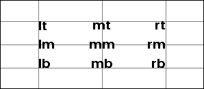

### The `visible` field

Every element type accepts an optional `visible` field. When falsy, the element is skipped entirely (no rendering, no position update). Defaults to `true`.

```yaml
{
    "type": "text",
    "value": "Hidden",
    "x": 10, 
    "y": 10,
    "visible": False
}
```

String values are coerced, which matters when `visible` is produced by a Home Assistant template (templates render to strings). The string `"false"` (case-insensitive) and empty/whitespace-only strings hide the element; any other non-empty string shows it. So a template that renders `"false"` hides the element as expected — rendering down to an empty string is no longer required.

### `rotation`

Every element type accepts an optional `rotation` (degrees, **positive = clockwise**, arbitrary values allowed) and an optional `pivot` controlling the point it rotates about. The element is rendered, then rotated in place and composited back, so any element type works.

| Field      | Required | Default          | Notes                                                                              |
|------------|----------|------------------|------------------------------------------------------------------------------------|
| `rotation` | no       | `0`              | Degrees, positive = clockwise                                                       |
| `pivot`    | no       | `"mm"` (center)  | [Anchor](#anchor) keyword relative to the element (e.g. `lt`, `mm`, `rb`), **or** `[x, y]` canvas coords (percentages allowed, e.g. `["50%", "50%"]`) |

> Not to be confused with the `image`/`dlimg`-only `rotate` field, which rotates the *source image before fitting it to the box*. Use `rotation` to tilt any rendered element on the canvas.

```yaml
[
    {
        "type": "text",
        "value": "Rotated",
        "x": 148,
        "y": 64,
        "size": 30,
        "anchor": "mm",
        "rotation": 45
    },
    # Illustration only — the gray "ghost" of the original orientation:
    {
        "type": "text",
        "value": "Rotated",
        "x": 148,
        "y": 64,
        "size": 30,
        "anchor": "mm",
        "color": "gray"
    },
    # Illustration only — a dot marking the pivot (the element's center):
    {
        "type": "circle",
        "x": 148,
        "y": 64,
        "radius": 3,
        "fill": "red"
    }
]
```

Only the first element matters for usage — the gray "ghost" shows the un-rotated original and the red dot marks the pivot (`pivot` defaults to the element's center; set e.g. `"pivot": "lt"` or `"pivot": [148, 64]` to move it).


### `mirror`

Every element type accepts an optional `mirror` to flip it about its `pivot`: `"h"` (horizontal), `"v"` (vertical), or `"hv"` (both). Unknown values are ignored.

| Field    | Required | Default         | Notes                                          |
|----------|----------|-----------------|------------------------------------------------|
| `mirror` | no       | —               | `"h"`, `"v"`, or `"hv"` (case-insensitive)     |
| `pivot`  | no       | `"mm"` (center) | Same as `rotation`: anchor keyword or `[x, y]` |

```yaml
[
    {
        "type": "polygon",
        "points": [[60, 30], [110, 30], [110, 45], [80, 45], [80, 98], [60, 98]],
        "fill": "red",
        "mirror": "h"
    },
    # Illustration only — the original outline and the flip axis:
    {
        "type": "polygon",
        "points": [[60, 30], [110, 30], [110, 45], [80, 45], [80, 98], [60, 98]],
        "outline": "gray",
        "width": 1
    },
    {
        "type": "line",
        "x_start": 85,
        "y_start": 20,
        "x_end": 85,
        "y_end": 108,
        "fill": "red",
        "width": 1
    }
]
```

The filled red shape is mirrored; the gray outline shows the original and the vertical red line marks the flip axis (the element's center by default).

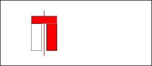

---

## Text

### `text`

Single-line text with optional wrapping, truncation, stroke, and inline color markup.

| Field          | Required | Default         | Notes                                                              |
|----------------|----------|-----------------|--------------------------------------------------------------------|
| `value`        | yes      | —               | Text content                                                       |
| `x`            | yes      | —               | X position                                                         |
| `y`            | no       | auto            | Y position; auto-stacks if omitted                                 |
| `font`         | no       | `"ppb"`         | Built-in name (`"ppb"`, `"rbm"`), file path, or PIL Font object    |
| `size`         | no       | `20`            | Font size in pixels                                                |
| `color`        | no       | `"black"`       | Text color                                                         |
| `anchor`       | no       | `"lt"` / `"la"` | Anchor point; defaults to `"la"` when text wraps to multiple lines |
| `max_width`    | no       | —               | Wrap text at this pixel width                                      |
| `truncate`     | no       | `false`         | Truncate with `…` instead of wrapping                              |
| `align`        | no       | `"left"`        | `"left"`, `"center"`, or `"right"`                                 |
| `spacing`      | no       | `5`             | Line spacing when wrapped                                          |
| `stroke_width` | no       | `0`             | Outline width                                                      |
| `stroke_fill`  | no       | `"white"`       | Outline color                                                      |
| `parse_colors` | no       | `false`         | Enable `[red]text[/red]` inline color markup                       |
| `y_padding`    | no       | `10`            | Extra space above when auto-stacking                               |

```yaml
{
    "type": "text",
    "value": "Hello",
    "x": "50%",
    "y": 20,
    "size": 32,
    "anchor": "mt",
}
```

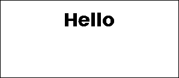

**Inline color markup** (requires `parse_colors: true`): wrap text in `[color]...[/color]` tags. Accepts all named colors, short names, and hex (`[#ff0000]red text[/#ff0000]`).

---

### `multiline`

Fixed-line text split by a delimiter, each line placed at a fixed vertical offset.

| Field          | Required | Default   | Notes                                       |
|----------------|----------|-----------|---------------------------------------------|
| `value`        | yes      | —         | Full text content                           |
| `x`            | yes      | —         | X position                                  |
| `delimiter`    | yes      | —         | Character used to split lines (e.g. `"\|"`) |
| `offset_y`     | yes      | —         | Pixels between each line                    |
| `y`            | no       | auto      | Y of first line                             |
| `font`         | no       | `"ppb"`   | Font                                        |
| `size`         | no       | `20`      | Font size                                   |
| `color`        | no       | `"black"` | Text color                                  |
| `anchor`       | no       | `"lm"`    | Anchor point                                |
| `align`        | no       | `"left"`  | Text alignment                              |
| `stroke_width` | no       | `0`       | Outline width                               |
| `stroke_fill`  | no       | `"white"` | Outline color                               |
| `parse_colors` | no       | `false`   | Inline color markup                         |

```yaml
{
    "type": "multiline",
    "value": "Line 1|Line 2|Line 3",
    "x": 10,
    "y": 10,
    "delimiter": "|",
    "offset_y": 24,
    "size": 18,
}
```

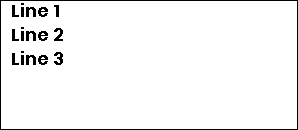

---

## Shapes

### `rectangle`

Rectangle with optional fill, outline, and rounded corners.

| Field     | Required | Default   | Notes                                                                                                             |
|-----------|----------|-----------|-------------------------------------------------------------------------------------------------------------------|
| `x_start` | yes      | —         | Left edge                                                                                                         |
| `y_start` | yes      | —         | Top edge                                                                                                          |
| `x_end`   | yes      | —         | Right edge                                                                                                        |
| `y_end`   | yes      | —         | Bottom edge                                                                                                       |
| `fill`    | no       | —         | Fill color                                                                                                        |
| `outline` | no       | `"black"` | Border color                                                                                                      |
| `width`   | no       | `1`       | Border width                                                                                                      |
| `corners` | no       | —         | Which corners to round: `"all"`, `"top_left"`, `"top_right"`, `"bottom_left"`, `"bottom_right"` (comma-separated) |
| `radius`  | no       | `10`      | Corner radius; only applies when `corners` is set                                                                 |
| `pattern` | no       | —         | Pattern drawn over the fill and under the outline: a name (`"hatch"`) or an object, see [Pattern](#pattern) |

```yaml
{
    "type": "rectangle",
    "x_start": 10,
    "y_start": 10,
    "x_end": 100,
    "y_end": 60,
    "fill": "black",
}
```


#### Pattern

Every closed shape (`rectangle`, `circle`, `ellipse`, `polygon`, `arc`) and the filled parts of
`progress_bar`, `diagram` bars and `plot` series can carry a `pattern`: hatching, stripes, dots,
a grid or a tone. It is drawn
over the `fill` (so the fill shows between the lines), inside the shape (rounded corners
included) and under the outline. Pattern pixels are exact palette colors, never blended or
anti-aliased, so every `dither` mode leaves them unchanged. The pattern is anchored to the
canvas, not to the shape, so shapes that touch continue the same pattern without a seam.

A renderer that does not know the field ignores it and draws the plain fill. Give a name for the
defaults (`"pattern": "hatch"`) or an object:

| Field     | Applies to | Default   | Notes                                                                                                          |
|-----------|------------|-----------|----------------------------------------------------------------------------------------------------------------|
| `type`    | all        | —         | `"hatch"`, `"dots"`, `"grid"` or `"tone"`; `"solid"`, `"none"` or an unknown type draws no pattern             |
| `color`   | all        | `"black"` | Any [color](#colors); alpha blends with what is below                                                          |
| `spacing` | hatch, dots, grid | `4` | Pixels between lines or dots (for slanted hatching measured across the lines)                                  |
| `width`   | hatch, dots, grid | `1` | Thickness of a line or size of a dot in pixels                                                                 |
| `angle`   | hatch      | `45`      | Degrees counter-clockwise from the x axis: `0` horizontal, `90` vertical, `45` rises to the right, `135` falls |
| `level`   | tone       | `50`      | Share of ink, `0` to `100`; an ordered (Bayer 8 x 8) dither, so 64 steps, each darker tone adding to the lighter |

<!-- screenshot: rectangle_patterns -->
```yaml
[
    {"type": "rectangle", "x_start": 8, "y_start": 8, "x_end": 68, "y_end": 60, "pattern": "hatch"},
    {"type": "rectangle", "x_start": 78, "y_start": 8, "x_end": 138, "y_end": 60, "pattern": {"type": "dots", "spacing": 5}},
    {"type": "rectangle", "x_start": 148, "y_start": 8, "x_end": 208, "y_end": 60, "pattern": {"type": "grid", "spacing": 8, "color": "red"}},
    {"type": "rectangle", "x_start": 218, "y_start": 8, "x_end": 288, "y_end": 60, "pattern": {"type": "tone", "level": 30}},
    {"type": "rectangle", "x_start": 8, "y_start": 70, "x_end": 138, "y_end": 120, "fill": "yellow", "radius": 12, "pattern": {"type": "hatch", "angle": 135, "color": "red", "width": 2, "spacing": 7}},
    {"type": "rectangle", "x_start": 148, "y_start": 70, "x_end": 288, "y_end": 120, "radius": 12, "width": 2, "pattern": {"type": "hatch", "angle": 0}},
]
```

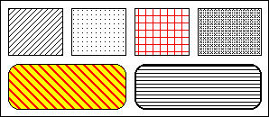

A `tone` is a fixed gray made of black and white pixels, the same on every shape, so it looks the
same in a preview and on the display. It does not depend on `dither`, unlike the `half_*` colors:

<!-- screenshot: rectangle_tones -->
```yaml
[
    {"type": "rectangle", "x_start": 8, "y_start": 8, "x_end": 24, "y_end": 120, "pattern": {"type": "tone", "level": 100}},
    {"type": "rectangle", "x_start": 30, "y_start": 8, "x_end": 46, "y_end": 120, "pattern": {"type": "tone", "level": 90}},
    {"type": "rectangle", "x_start": 52, "y_start": 8, "x_end": 68, "y_end": 120, "pattern": {"type": "tone", "level": 80}},
    {"type": "rectangle", "x_start": 74, "y_start": 8, "x_end": 90, "y_end": 120, "pattern": {"type": "tone", "level": 70}},
    {"type": "rectangle", "x_start": 96, "y_start": 8, "x_end": 112, "y_end": 120, "pattern": {"type": "tone", "level": 60}},
    {"type": "rectangle", "x_start": 118, "y_start": 8, "x_end": 134, "y_end": 120, "pattern": {"type": "tone", "level": 50}},
    {"type": "rectangle", "x_start": 140, "y_start": 8, "x_end": 156, "y_end": 120, "pattern": {"type": "tone", "level": 40}},
    {"type": "rectangle", "x_start": 162, "y_start": 8, "x_end": 178, "y_end": 120, "pattern": {"type": "tone", "level": 30}},
    {"type": "rectangle", "x_start": 184, "y_start": 8, "x_end": 200, "y_end": 120, "pattern": {"type": "tone", "level": 20}},
    {"type": "rectangle", "x_start": 206, "y_start": 8, "x_end": 222, "y_end": 120, "pattern": {"type": "tone", "level": 10}},
    {"type": "rectangle", "x_start": 238, "y_start": 8, "x_end": 288, "y_end": 120, "fill": "half_black", "outline": None},
]
```

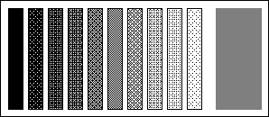

On the right, `half_black` for comparison: one fixed tone whose pixels depend on the dithering of
the display.

All pattern types, with angles and parameters, and how a pattern layers with a fill, an outline,
rounded corners and a color with alpha:

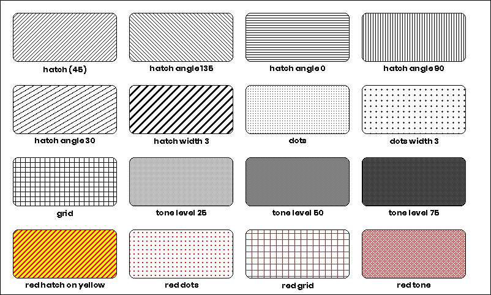

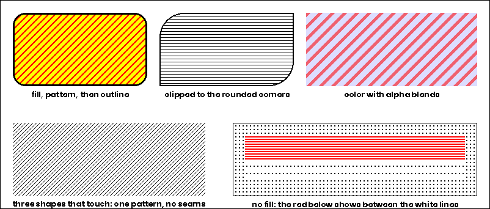

#### Patterns on every shape

The same `pattern` field works on every shape that has an inside, always with the same rules:
fill first, then the pattern clipped to the silhouette, then the outline.

| Element | Where the pattern goes |
|---------|------------------------|
| `rectangle`, `circle`, `ellipse`, `polygon` | the whole shape |
| `arc` | the pie slice (a `pattern` turns the arc into a pie slice, like `fill` does) |
| `progress_bar` | `pattern` on the progress part, `background_pattern` on the empty track |
| `diagram` | `bars.pattern` on every bar |
| `plot` | `pattern` in a series: the area between the line and the bottom of the diagram, in the series color unless the pattern sets its own |

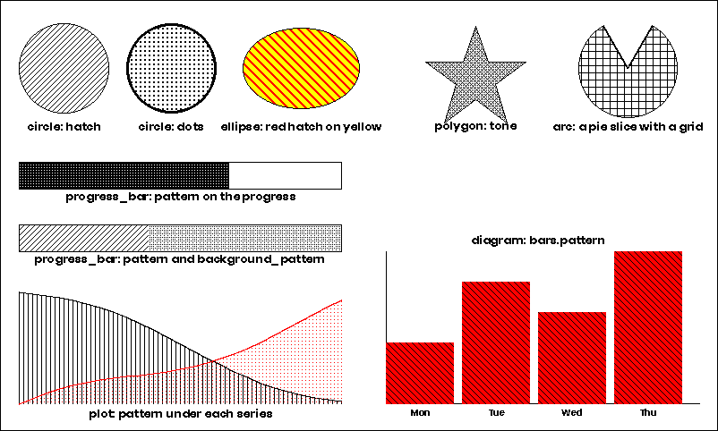

A pattern is made of palette pixels, so a display that dithers its picture leaves it unchanged,
where a gray fill turns into noise:

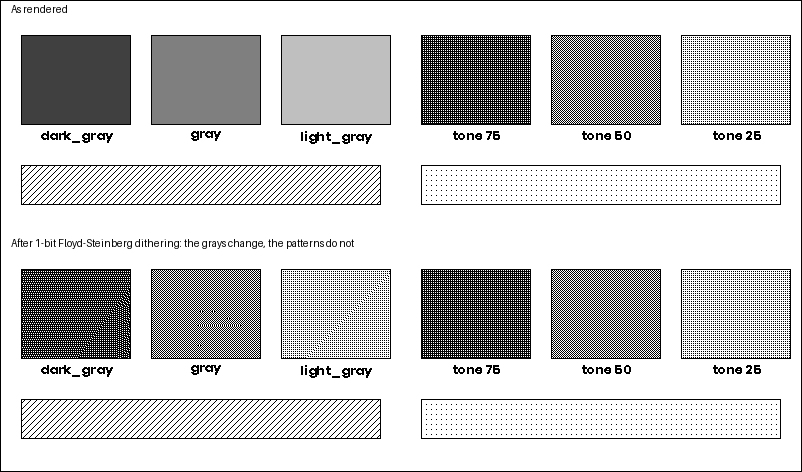

---

### `rectangle_pattern`

Repeating grid of rectangles — useful for dot matrices, grids, and decorative patterns.

| Field                | Required | Default   | Notes                             |
|----------------------|----------|-----------|-----------------------------------|
| `x_start`            | yes      | —         | Starting X                        |
| `y_start`            | yes      | —         | Starting Y                        |
| `x_size`             | yes      | —         | Width of each rectangle           |
| `y_size`             | yes      | —         | Height of each rectangle          |
| `x_repeat`           | yes      | —         | Number of columns                 |
| `y_repeat`           | yes      | —         | Number of rows                    |
| `x_offset`           | yes      | —         | Horizontal gap between rectangles |
| `y_offset`           | yes      | —         | Vertical gap between rectangles   |
| `fill`               | no       | —         | Fill color                        |
| `outline`            | no       | `"black"` | Border color                      |
| `width`              | no       | `1`       | Border width                      |
| `corners` / `radius` | no       | —         | Same as `rectangle`               |

```yaml
{
    "type": "rectangle_pattern",
    "x_start": 10,
    "y_start": 10,
    "x_size": 8,
    "y_size": 8,
    "x_repeat": 5,
    "y_repeat": 3,
    "x_offset": 4,
    "y_offset": 4,
    "fill": "black",
}
```

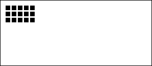

---

### `circle`

Circle defined by center point and radius.

| Field     | Required | Default   | Notes            |
|-----------|----------|-----------|------------------|
| `x`       | yes      | —         | Center X         |
| `y`       | yes      | —         | Center Y         |
| `radius`  | yes      | —         | Radius in pixels |
| `fill`    | no       | —         | Fill color       |
| `outline` | no       | `"black"` | Border color     |
| `width`   | no       | `1`       | Border width     |
| `pattern` | no       | —         | Pattern drawn over the fill and under the outline: a name (`"hatch"`) or an object, see [Pattern](#pattern) |

```yaml
{
    "type": "circle",
    "x": "50%",
    "y": "50%",
    "radius": 20,
    "fill": "green",
    "outline": "black",
}
```


With a pattern:

<!-- screenshot: circle_patterns -->
```yaml
[
    {"type": "circle", "x": 40, "y": 64, "radius": 32, "pattern": "hatch"},
    {"type": "circle", "x": 112, "y": 64, "radius": 32, "pattern": {"type": "dots", "spacing": 5}},
    {"type": "circle", "x": 184, "y": 64, "radius": 32, "fill": "yellow", "width": 3, "pattern": {"type": "hatch", "color": "red", "angle": 135, "spacing": 6}},
    {"type": "circle", "x": 256, "y": 64, "radius": 32, "pattern": {"type": "tone", "level": 40}},
]
```

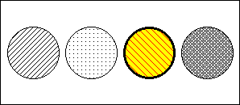

---

### `ellipse`

Ellipse defined by a bounding box.

| Field     | Required | Default   | Notes        |
|-----------|----------|-----------|--------------|
| `x_start` | yes      | —         | Left edge    |
| `y_start` | yes      | —         | Top edge     |
| `x_end`   | yes      | —         | Right edge   |
| `y_end`   | yes      | —         | Bottom edge  |
| `fill`    | no       | —         | Fill color   |
| `outline` | no       | `"black"` | Border color |
| `width`   | no       | `1`       | Border width |
| `pattern` | no       | —         | Pattern drawn over the fill and under the outline: a name (`"hatch"`) or an object, see [Pattern](#pattern) |

```yaml
{
    "type": "ellipse",
    "x_start": 10,
    "y_start": 10,
    "x_end": 100,
    "y_end": 60,
    "fill": "yellow",
}
```

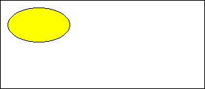

With a pattern:

<!-- screenshot: ellipse_patterns -->
```yaml
[
    {"type": "ellipse", "x_start": 8, "y_start": 12, "x_end": 140, "y_end": 116, "pattern": {"type": "grid", "spacing": 8}},
    {"type": "ellipse", "x_start": 156, "y_start": 12, "x_end": 288, "y_end": 116, "fill": "yellow", "pattern": {"type": "hatch", "angle": 45, "color": "red", "width": 2, "spacing": 7}},
]
```

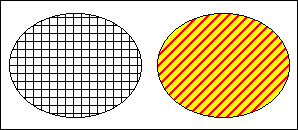

---

### `polygon`

Arbitrary polygon defined by a list of vertices.

| Field     | Required | Default   | Notes                  |
|-----------|----------|-----------|------------------------|
| `points`  | yes      | —         | List of `[x, y]` pairs |
| `fill`    | no       | —         | Fill color             |
| `outline` | no       | `"black"` | Border color           |
| `pattern` | no       | —         | Pattern drawn over the fill and under the outline: a name (`"hatch"`) or an object, see [Pattern](#pattern) |

```yaml
{
    "type": "polygon",
    "points": [[10, 50], [50, 10], [90, 50], [50, 90]],
    "fill": "blue",
}
```

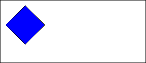

With a pattern:

<!-- screenshot: polygon_patterns -->
```yaml
[
    {"type": "polygon", "points": [[10, 116], [90, 116], [50, 12]], "pattern": "hatch"},
    {"type": "polygon", "points": [[110, 64], [160, 12], [210, 64], [160, 116]], "fill": "yellow", "pattern": {"type": "dots", "color": "red", "width": 2, "spacing": 6}},
    {"type": "polygon", "points": [[230, 116], [290, 116], [290, 12]], "pattern": {"type": "tone", "level": 30}},
]
```

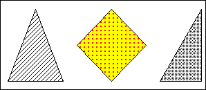

---

### `arc`

Arc or pie slice defined by center, radius, and angle range.

| Field         | Required | Default   | Notes                                                 |
|---------------|----------|-----------|-------------------------------------------------------|
| `x`           | yes      | —         | Center X                                              |
| `y`           | yes      | —         | Center Y                                              |
| `radius`      | yes      | —         | Radius in pixels                                      |
| `start_angle` | yes      | —         | Start angle in degrees (0 = right, counter-clockwise) |
| `end_angle`   | yes      | —         | End angle in degrees                                  |
| `fill`        | no       | —         | Fill color (creates a pie slice)                      |
| `pattern`     | no       | —         | Pattern for the pie slice, see [Pattern](#pattern); also makes it a pie slice |
| `outline`     | no       | `"black"` | Border color                                          |
| `width`       | no       | `1`       | Border width                                          |

```yaml
{
    "type": "arc",
    "x": 50,
    "y": 50,
    "radius": 30,
    "start_angle": 0,
    "end_angle": 270,
    "outline": "black",
    "fill": "half_red",
}
```

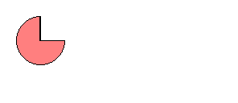

With a pattern:

<!-- screenshot: arc_patterns -->
```yaml
[
    {"type": "arc", "x": 64, "y": 64, "radius": 52, "start_angle": 0, "end_angle": 270, "pattern": "hatch"},
    {"type": "arc", "x": 220, "y": 64, "radius": 52, "start_angle": -90, "end_angle": 200, "fill": "yellow", "pattern": {"type": "hatch", "angle": 135, "color": "red", "spacing": 6}},
]
```

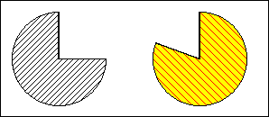

---

### `line`

Straight line between two points with optional dashing.

| Field          | Required | Default   | Notes                              |
|----------------|----------|-----------|------------------------------------|
| `x_start`      | yes      | —         | Start X                            |
| `x_end`        | yes      | —         | End X                              |
| `y_start`      | no       | auto      | Start Y                            |
| `y_end`        | no       | `y_start` | End Y (horizontal line if omitted) |
| `fill`         | no       | `"black"` | Line color                         |
| `width`        | no       | `1`       | Line width                         |
| `dashed`       | no       | `false`   | Enable dashed style                |
| `dash_length`  | no       | `5`       | Length of each dash                |
| `space_length` | no       | `3`       | Gap between dashes                 |

```yaml
{
    "type": "line",
    "x_start": "10%",
    "y_start": "50%",
    "x_end": "90%",
    "y_end": "50%",
    "fill": "black",
}
```

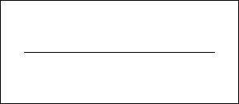

---

## Icons

Icons use the bundled [Material Design Icons](https://pictogrammers.com/library/mdi/) font (7,000+ icons). Pass the icon name with or without the `mdi:` prefix.

### `icon`

Single MDI icon.

| Field    | Required | Default   | Notes                                    |
|----------|----------|-----------|------------------------------------------|
| `value`  | yes      | —         | Icon name, e.g. `"home"` or `"mdi:home"` |
| `x`      | yes      | —         | X position                               |
| `y`      | yes      | —         | Y position                               |
| `size`   | yes      | —         | Icon size in pixels                      |
| `color`  | no       | `"black"` | Icon color                               |
| `anchor` | no       | `"mm"`    | Anchor point                             |

```yaml
{
    "type": "icon",
    "value": "mdi:thermometer",
    "x": "50%",
    "y": "50%",
    "size": 48,
    "anchor": "mm",
}
```

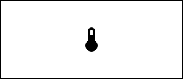

---

### `icon_sequence`

Row or column of MDI icons.

| Field       | Required | Default    | Notes                                    |
|-------------|----------|------------|------------------------------------------|
| `icons`     | yes      | —          | List of icon names                       |
| `x`         | yes      | —          | Starting X                               |
| `y`         | yes      | —          | Starting Y                               |
| `size`      | yes      | —          | Icon size in pixels                      |
| `direction` | no       | `"right"`  | `"right"`, `"left"`, `"up"`, or `"down"` |
| `spacing`   | no       | `size / 4` | Gap between icons                        |
| `color`     | no       | `"black"`  | Icon color                               |
| `anchor`    | no       | `"mm"`     | Anchor point                             |

```yaml
{
    "type": "icon_sequence",
    "icons": ["mdi:weather-sunny", "mdi:weather-cloudy", "mdi:weather-rainy"],
    "x": 20,
    "y": 20,
    "size": 32,
}
```

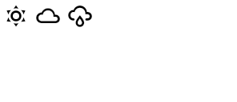

---

## Media

### `dlimg`

Image from a URL, file path, data URI, bytes, or PIL Image object. Resized to fit the specified dimensions.

> **Note:** Entity IDs are not resolved — the caller must pass a URL, file path, or image object directly.

| Field           | Required | Default     | Notes                                                          |
|-----------------|----------|-------------|----------------------------------------------------------------|
| `url`           | yes      | —           | Source: HTTP URL, file path, data URI, `bytes`, or `PIL.Image` |
| `x`             | yes      | —           | X position                                                     |
| `y`             | yes      | —           | Y position                                                     |
| `xsize`         | yes      | —           | Target width                                                   |
| `ysize`         | yes      | —           | Target height                                                  |
| `rotate`        | no       | `0`         | Rotation in degrees                                            |
| `resize_method` | no       | `"stretch"` | `"stretch"`, `"crop"`, `"cover"`, or `"contain"`               |

```yaml
{
    "type": "dlimg",
    "url": "https://picsum.photos/seed/odl/200/150",
    "x": 0,
    "y": 0,
    "xsize": 200,
    "ysize": 150,
    "resize_method": "cover",
}
```

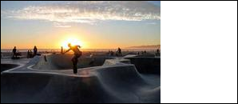

---

### `qrcode`

QR code generated from any text or URL.

| Field     | Required | Default   | Notes                      |
|-----------|----------|-----------|----------------------------|
| `data`    | yes      | —         | QR code content            |
| `x`       | yes      | —         | X position                 |
| `y`       | yes      | —         | Y position                 |
| `color`   | no       | `"black"` | Foreground color           |
| `bgcolor` | no       | `"white"` | Background color           |
| `border`  | no       | `1`       | Quiet zone size in modules |
| `boxsize` | no       | `2`       | Pixel size of each module  |

```yaml
{
    "type": "qrcode",
    "data": "https://opendisplay.org",
    "x": 10,
    "y": 10,
}
```

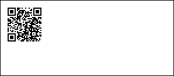

---

## Visualizations

### `progress_bar`

Horizontal or vertical progress bar with optional percentage label.

| Field             | Required | Default   | Notes                                    |
|-------------------|----------|-----------|------------------------------------------|
| `x_start`         | yes      | —         | Left edge                                |
| `y_start`         | yes      | —         | Top edge                                 |
| `x_end`           | yes      | —         | Right edge                               |
| `y_end`           | yes      | —         | Bottom edge                              |
| `progress`        | yes      | —         | Fill level 0–100 (clamped automatically) |
| `direction`       | no       | `"right"` | `"right"`, `"left"`, `"up"`, or `"down"` |
| `fill`            | no       | `"red"`   | Progress fill color                      |
| `background`      | no       | `"white"` | Empty track color                        |
| `outline`         | no       | `"black"` | Border color                             |
| `width`           | no       | `1`       | Border width                             |
| `pattern`         | no       | —         | Pattern on the progress part, see [Pattern](#pattern) |
| `background_pattern` | no    | —         | Pattern on the empty track               |
| `show_percentage` | no       | `false`   | Overlay percentage text                  |
| `font_name`       | no       | `"ppb"`   | Font for percentage text                 |

```yaml
{
    "type": "progress_bar",
    "x_start": "10%",
    "y_start": 50,
    "x_end": "90%",
    "y_end": 70,
    "progress": 72,
    "fill": "accent",
    "show_percentage": True,
}
```

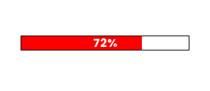

With a pattern:

<!-- screenshot: progress_bar_patterns -->
```yaml
[
    {"type": "progress_bar", "x_start": 10, "y_start": 12, "x_end": 286, "y_end": 40, "progress": 60, "fill": "black", "pattern": {"type": "dots", "color": "white", "spacing": 3}},
    {"type": "progress_bar", "x_start": 10, "y_start": 52, "x_end": 286, "y_end": 80, "progress": 35, "fill": "white", "pattern": "hatch", "background_pattern": {"type": "tone", "level": 20}},
    {"type": "progress_bar", "x_start": 10, "y_start": 92, "x_end": 286, "y_end": 120, "progress": 80, "fill": "yellow", "pattern": {"type": "hatch", "color": "red", "width": 2, "spacing": 6}},
]
```

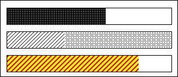

---

### `plot`

Time-series line chart with configurable axes, grid, and legends. Requires a `DataProvider` in the drawing context to supply historical data.

| Field          | Required | Default      | Notes                              |
|----------------|----------|--------------|------------------------------------|
| `data`         | yes      | —            | List of series configs (see below) |
| `x_start`      | no       | `0`          | Chart left edge                    |
| `y_start`      | no       | `0`          | Chart top edge                     |
| `x_end`        | no       | image width  | Chart right edge                   |
| `y_end`        | no       | image height | Chart bottom edge                  |
| `duration`     | no       | `86400`      | Time window in seconds             |
| `low` / `high` | no       | auto         | Y-axis range override              |
| `font`         | no       | `"ppb"`      | Font for labels                    |

<details>
<summary>Series, axis, and legend options</summary>

**Each series in `data`:**

| Field         | Default   | Notes                                           |
|---------------|-----------|-------------------------------------------------|
| `entity`      | required  | Data source identifier passed to `DataProvider` |
| `color`       | required  | Line color                                      |
| `width`       | `2`       | Line width                                      |
| `smooth`      | `false`   | Smooth the line                                 |
| `line_style`  | `"solid"` | `"solid"`, `"dashed"`, or `"dotted"`            |
| `pattern`     | —         | Pattern for the area under the line, in the series color unless it sets `color`; see [Pattern](#pattern) |
| `show_points` | `false`   | Draw data points                                |
| `span_gaps`   | `false`   | Connect across missing values                   |

**`yaxis`** (optional dict):

| Field        | Default    |
|--------------|------------|
| `tick_every` | required   |
| `color`      | `"black"`  |
| `grid`       | `true`     |
| `grid_style` | `"dotted"` |

**`xaxis`** (optional dict):

| Field        | Default    |
|--------------|------------|
| `color`      | `"black"`  |
| `grid`       | `true`     |
| `grid_style` | `"dotted"` |

**`ylegend`** (optional dict):

| Field      | Default   |
|------------|-----------|
| `position` | `"left"`  |
| `size`     | `10`      |
| `color`    | `"black"` |

**`xlegend`** (optional dict):

| Field           | Default    |
|-----------------|------------|
| `interval`      | required   |
| `format`        | `"%H:%M"`  |
| `position`      | `"bottom"` |
| `size`          | `10`       |
| `snap_to_hours` | `true`     |

</details>

```yaml
{
  "type": "plot",
  "x_start": 0,
  "y_start": 6,
  "x_end": 292,
  "y_end": 120,
  "round_values": True,
  "data":
    [
      {
        "entity": "sensor.temperature",
        "color": "red",
        "width": 2
      }
    ],
  "yaxis":
    {
      "tick_every": 2,
      "grid_color": "gray"
    },
  "ylegend":
    {
      "position": "left"
    },
  "xaxis":
    {
      "color": "black",
      "grid": False
    },
  "xlegend":
    {
      "interval": 14400
    }
}
```

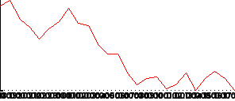

---

With a pattern under the line:

<!-- screenshot: plot_patterns -->
```yaml
{
    "type": "plot",
    "x_start": 0,
    "y_start": 6,
    "x_end": 292,
    "y_end": 120,
    "round_values": True,
    "data": [
        {
            "entity": "sensor.temperature",
            "color": "black",
            "width": 2,
            "pattern": {"type": "hatch", "angle": 90, "spacing": 5},
        },
        {
            "entity": "sensor.humidity",
            "color": "red",
            "width": 2,
            "pattern": {"type": "dots", "spacing": 4},
        },
    ],
}
```

Series are drawn in order, so a later series paints over an earlier one. The plot draws no
background and no frame: axes, grid and legends appear only when `yaxis`, `xaxis`, `ylegend`
and `xlegend` are given, so the example above is just the lines and the areas under them.

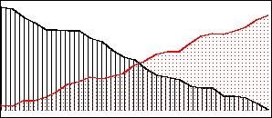

### `diagram`

Simple bar chart with labeled axes.

| Field    | Required | Default     | Notes                        |
|----------|----------|-------------|------------------------------|
| `x`      | yes      | —           | X position                   |
| `height` | yes      | —           | Diagram height               |
| `width`  | no       | image width | Diagram width                |
| `margin` | no       | `20`        | Margin from edges            |
| `bars`   | no       | —           | Bar chart config (see below) |

**`bars` config:**

| Field          | Notes                                                               |
|----------------|---------------------------------------------------------------------|
| `values`       | Semicolon-separated `"label,value"` pairs: `"Mon,10;Tue,20;Wed,15"` |
| `color`        | Bar fill color                                                      |
| `font`         | Font name                                                           |
| `legend_size`  | Label font size                                                     |
| `legend_color` | Label color                                                         |
| `pattern`      | Pattern on every bar, over `color`; see [Pattern](#pattern)         |

```yaml
{
    "type": "diagram",
    "x": 0,
    "height": 128,
    "bars": {
        "values": "Mon,10;Tue,20;Wed,15",
        "color": "black",
    },
}
```

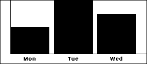


With a pattern on the bars:

<!-- screenshot: diagram_patterns -->
```yaml
{
    "type": "diagram",
    "x": 0,
    "height": 128,
    "bars": {
        "values": "Mon,10;Tue,20;Wed,15",
        "color": "red",
        "pattern": {"type": "hatch", "color": "black", "angle": 135, "spacing": 5},
    },
}
```

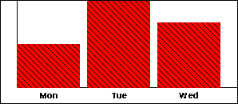

---

## Debug

### `debug_grid`

Renders a coordinate grid over the image. Useful during layout development.

| Field             | Required | Default       | Notes                    |
|-------------------|----------|---------------|--------------------------|
| `spacing`         | no       | `20`          | Grid cell size in pixels |
| `line_color`      | no       | `"black"`     | Grid line color          |
| `dashed`          | no       | `true`        | Use dashed lines         |
| `dash_length`     | no       | `2`           | Dash segment length      |
| `space_length`    | no       | `4`           | Gap between dashes       |
| `show_labels`     | no       | `true`        | Show coordinate labels   |
| `label_step`      | no       | `spacing * 2` | Interval between labels  |
| `label_color`     | no       | `"black"`     | Label color              |
| `label_font_size` | no       | `12`          | Label font size          |
| `font`            | no       | `"ppb"`       | Font for labels          |

```yaml
{
    "type": "debug_grid",
    "spacing": 20,
    "line_color": "gray",
}
```

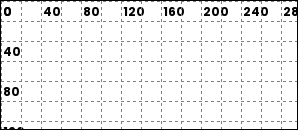